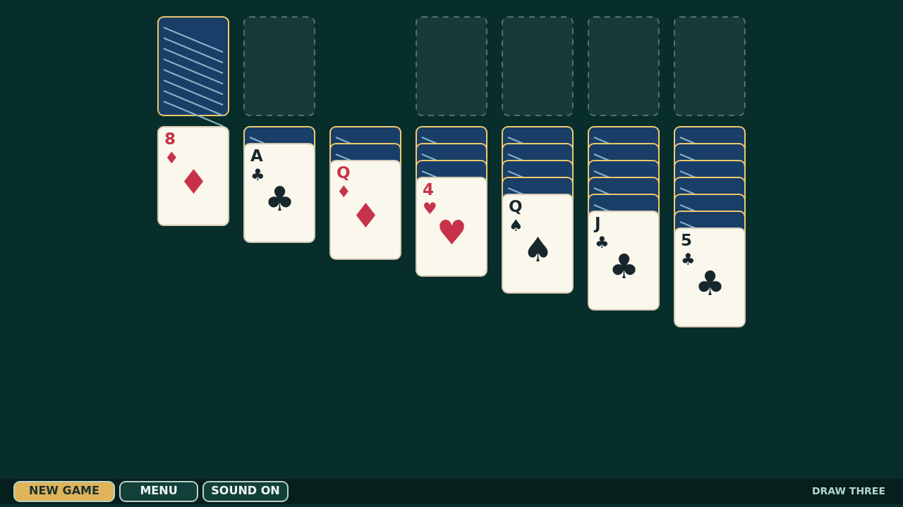

# Cascade

Cascade is draw-three Klondike on a deep green felt table. Turn the stock, free buried cards by building alternating colors downward, and assemble every suit from Ace to King.

Cards move naturally by mouse or touch, and an exposed card can be sent straight home with a double-click. Clear typography and generous spacing keep the board calm and readable.

Complete the foundations and the quiet table erupts: the deck launches card by card, bouncing across the floor and painting a lasting trail over the felt.

